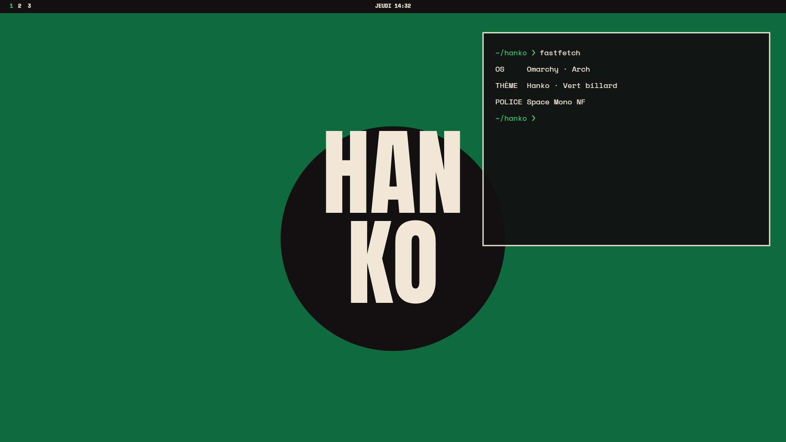

# Hanko · Vert billard — Omarchy theme

A minimal, editorial dark theme for [Omarchy](https://omarchy.org): near-black surfaces, cream type, one strong colour (Vert billard `#36d27e`), poster-style wallpapers set in Anton.



## Install
```
omarchy-theme-install https://github.com/MoozyDev/omarchy-hanko-vert-billard-theme
```
Works on its own (palette, wallpapers, previews, icons). The optional extras (bar icons, lock screen, desktop widgets, screensaver, sounds) live in the separate `omarchy-hanko-extras` repo.

## Contents
- `colors.toml` — full palette (`mode = "dark"`)
- `icons.theme` — `Yaru-sage`
- `backgrounds/` — 01 to 05, 3840×2160 + `-vertical` 2160×3840 (key content kept in a centred 9:16 band)
- `webapps/`, `apps/` — 512 px icons (copy to `~/.local/share/applications/icons/`)
- `boot/` — Limine colour block, Plymouth colours
- `apps-themes/` — Spotify (Spicetify), Discord (Vesktop), Obsidian

## Fonts
Anton (display, OFL) · SpaceMono Nerd Font (`ttf-space-mono-nerd`).

---

**En français** — Variante Vert billard du thème Hanko : fond presque noir, texte crème, une seule couleur forte. Le dossier suffit seul ; les éléments à coder (barre, verrouillage, widgets, veille) sont dans le dépôt `extras`.
